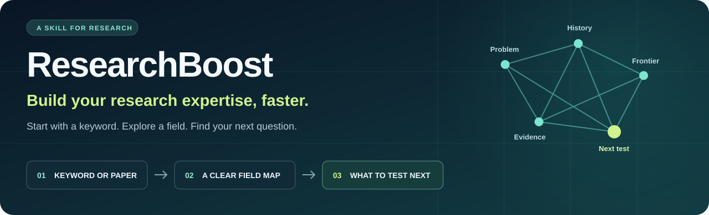
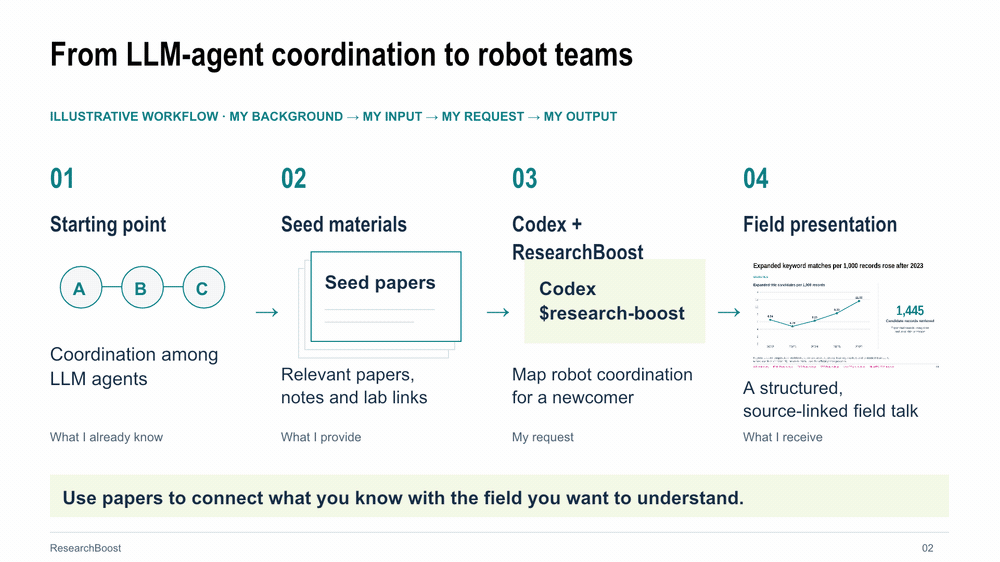
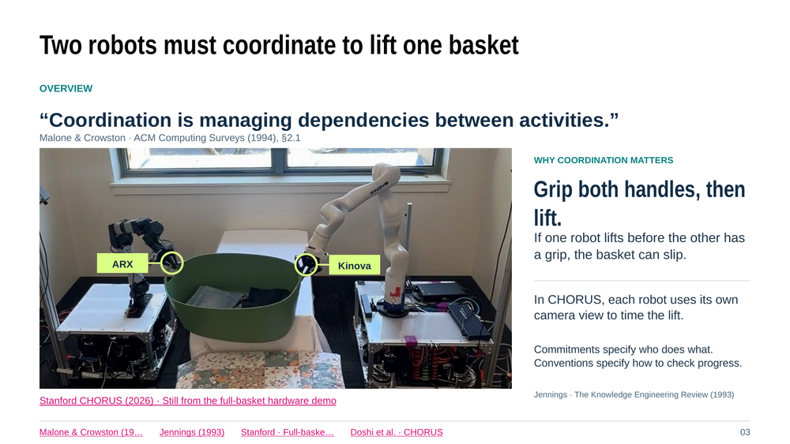
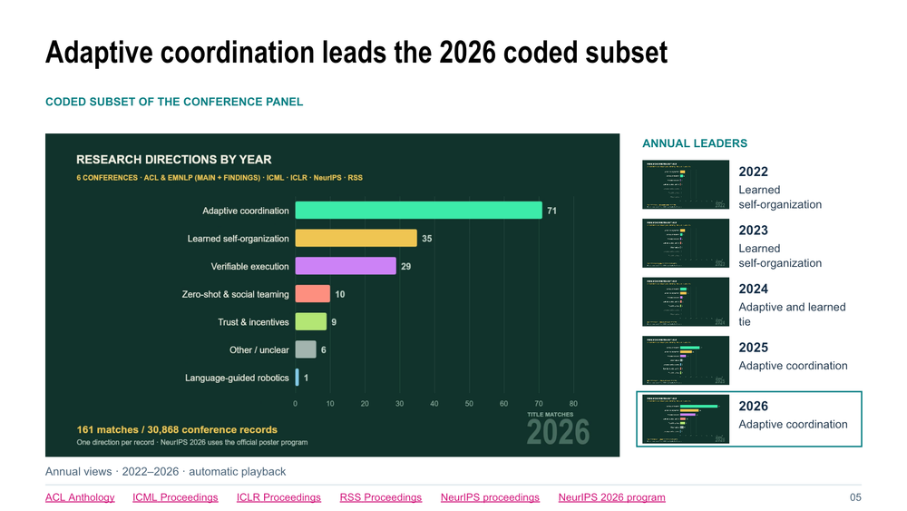
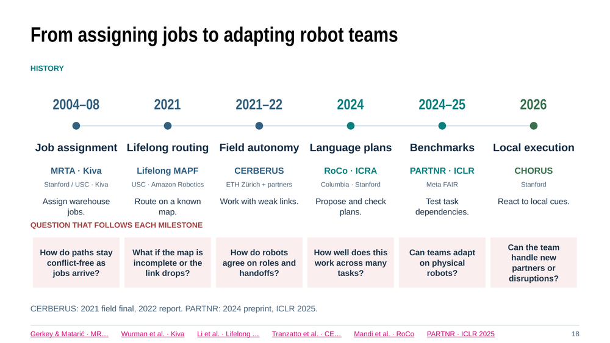
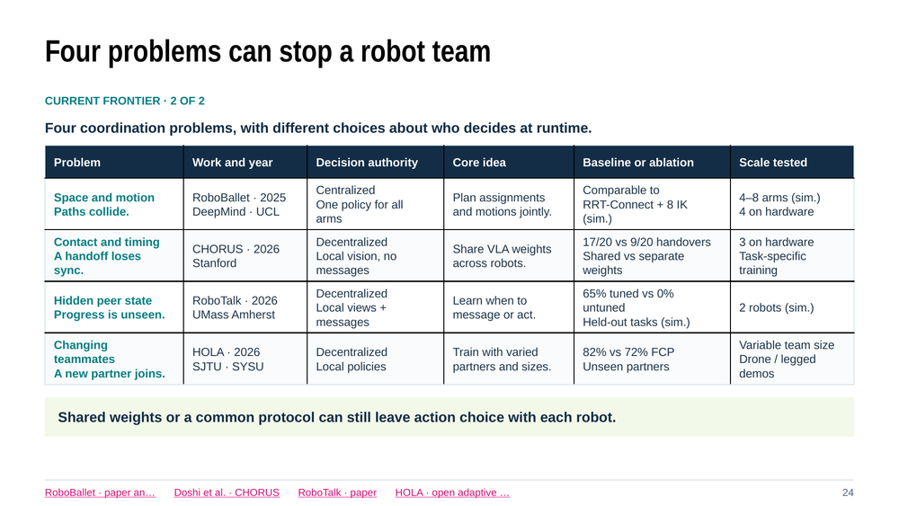
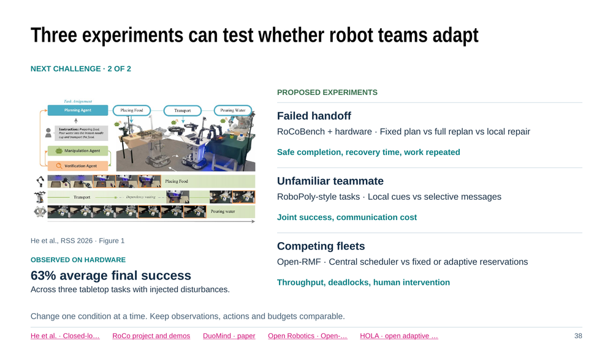
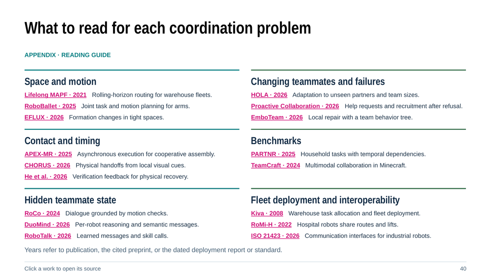

<p align="center">
  <strong>Turn “I’m new to this field” into “I know what to read, compare, and test next.”</strong>
</p>

<p align="center">
  <a href="#quickstart">Get started</a> ·
  <a href="examples/robotics-coordination/demo.pptx">Example PPTX</a> ·
  <a href="examples/robotics-coordination/promo/researchboost-promo.mp4">Watch the 7:59 demo</a> ·
  <a href="#inside-the-deck-six-things-that-help-you-understand-a-field">Explore the slides</a>
</p>

ResearchBoost helps you get up to speed in a research field by expanding your starting point—a keyword, paper, researcher, or group—into a connected view of the literature. Discover the core problems, follow how ideas evolved, map research communities, and compare the current frontier. Turn that understanding into an editable presentation, a guided reading path, and concrete questions to investigate next.

> **However you use AI to accelerate your research, someone is moving faster.**
>
> Start with a keyword. Add your best materials when you have them.

## What you receive

- Editable presentation (`.pptx`)
- PDF presentation (`.pdf`)
- English speaker text (`.md`)
- Reading path (`.md`)
- Evidence ledger (`.csv`)
- Corpus and coverage files for reported statistics (`.csv` / `.json`)

## Watch the skill in action

**The starting point:** “I work on multi-agent coordination for LLM agents. Now I want to understand coordination in robot teams.”

This promotional walkthrough showcases the skill’s output: an editable research presentation and the evidence behind it. The researcher supplies related papers and materials to **Codex + ResearchBoost**. The resulting presentation connects familiar agent ideas with robotics problems, evidence, and evaluation settings. The walkthrough explains **what each slide contributes and why it is needed to understand the field**.

[](examples/robotics-coordination/promo/researchboost-promo.mp4)

**[▶ Watch the full 7:59 promotional video with English narration](examples/robotics-coordination/promo/researchboost-promo.mp4)**

*The preview animates inside this README. Open the full video for narration and all 40 main demo slides. The annual chart plays every year from 2022 to 2026; the five selection criteria appear immediately before the frontier.*

## Inside the deck: six things that help you understand a field

**Multi-Agent Coordination — The research landscape and a closer look at multi-robot teams**

The included **46-slide robotics deck** is a worked example of the skill’s output. The previews below show the kind of presentation Codex can create for your own topic. Each slide answers a question a newcomer needs to ask. Click a preview to open its page in the example PDF.

<table>
  <tr>
    <td width="50%" valign="top">
      <h3>01 · What problem are we solving?</h3>
      <a href="examples/robotics-coordination/demo.pdf#page=3"></a>
      <p><strong>Start with a concrete failure.</strong> A two-robot task makes timing, roles, and shared constraints tangible before introducing methods.</p>
    </td>
    <td width="50%" valign="top">
      <h3>02 · Where is attention moving?</h3>
      <a href="examples/robotics-coordination/demo.pdf#page=5"></a>
      <p><strong>Read the landscape with context.</strong> Scoped counts and annual views help you spot changing directions and understand what the sample actually covers.</p>
    </td>
  </tr>
  <tr>
    <td width="50%" valign="top">
      <h3>03 · Why did the ideas change?</h3>
      <a href="examples/robotics-coordination/demo.pdf#page=18"></a>
      <p><strong>Learn the logic behind the timeline.</strong> Connect changing problems and assumptions to the ideas they made necessary.</p>
    </td>
    <td width="50%" valign="top">
      <h3>04 · How do frontier approaches differ?</h3>
      <a href="examples/robotics-coordination/demo.pdf#page=24"></a>
      <p><strong>Compare approaches on a common map.</strong> Organize representative works by problem, decision authority, mechanism, and scale before examining the details.</p>
    </td>
  </tr>
  <tr>
    <td width="50%" valign="top">
      <h3>05 · What could I investigate next?</h3>
      <a href="examples/robotics-coordination/demo.pdf#page=38"></a>
      <p><strong>Turn understanding into a research question.</strong> Tie gaps to concrete experiments with baselines and metrics you can discuss, refine, and test.</p>
    </td>
    <td width="50%" valign="top">
      <h3>06 · What should I read first?</h3>
      <a href="examples/robotics-coordination/demo.pdf#page=40"></a>
      <p><strong>Leave with a route into the literature.</strong> Follow papers grouped by the problems they solve, with a reason to read each one.</p>
    </td>
  </tr>
</table>

**Build your expertise one connection at a time:** explain the problem → interpret the evidence → compare the methods → choose what to read and test.

[Download the editable demo PPTX](examples/robotics-coordination/demo.pptx) · [Browse the PDF](examples/robotics-coordination/demo.pdf) · [Read the example guide](examples/robotics-coordination/README.md)

The demo retains a November 2026 evidence snapshot. [Its guide](examples/robotics-coordination/README.md#evidence-snapshot-and-limits) explains the different populations behind the statistics and the coverage limits. A new topic requires a new corpus and source check.

## Quickstart

### 1. Get the project and install the skill

Download this repository as a ZIP and extract it, or clone it. In a terminal opened at the repository root, run:

```sh
python3 scripts/install.py --project /path/to/your/research-project
```

The installer creates `.agents/skills/research-boost/` in your research project and refuses to overwrite an existing skill. To install for all your projects, use `python3 scripts/install.py --user` instead. See [installation and requirements](docs/INSTALL.md).

### 2. Choose a starting point

**A few keywords are enough.** You can also begin with one paper, a researcher’s name, or a lab or group. Tell ResearchBoost what you want to understand, and it will expand the search from there.

**For more context, optionally add your best materials:** useful papers, literature reviews, curated reading lists, notes, course or talk materials, and research-group links. These help focus the result on your interests. The skill should verify supplied claims, identify gaps, and include relevant alternatives.

### 3. Open your research project in Codex and invoke the skill

```text
Use $research-boost to help me understand multi-robot coordination.

My background: multi-agent coordination for LLM agents.
Start with these keywords: robot teams, task allocation, communication.
Optional materials: any papers, reviews, notes, or group links I attach.

Expand beyond these seeds and include alternative approaches.
Audience: ML researchers new to robotics. Make a 30-minute English talk.

Deliver an editable .pptx, a PDF, separate English speaker text,
an evidence ledger, and a problem-based reading path.
Explain the core problem, scoped statistics, community, history,
frontier selection criteria, methods, evidence, and next experiments.
Verify current primary sources and record the cutoff date.
```

If the skill does not appear, restart Codex. Research and slide generation use your agent host’s source access and presentation tools. Generating the editable PPTX requires a presentation-capable host; in Codex, use the Presentations skill when available. Installation and brief preparation need no API key or extra Python packages. [Copy a materials-first prompt](examples/prompts/materials.md).

## Four easy ways to start

Start with any one of these. Add **your best materials**, when available, to give the skill more context.

| Starting point | Give ResearchBoost | It helps you build |
| --- | --- | --- |
| **Keywords** | A few words about your topic; add a date range or exclusions if useful. | Query families and a scoped view across relevant venues. |
| **Papers and materials** | One paper or link; add reviews, reading lists, notes, or course/talk materials if you have them. | A problem map, traced claims, and an expanded literature view. |
| **A researcher** | A name; an official profile or affiliation helps resolve identity. | Verified contributions and relevant work beyond that person’s circle. |
| **A research group** | A lab/team name or its website. | A map of public projects, papers, and neighboring groups. |

Combine inputs whenever useful. A person or group can seed a wider exploration of the field. [Browse prompts](examples/prompts/) · [Customize your brief](docs/CUSTOMIZE.md).

<details>
<summary><strong>Prepare a reusable brief without running research</strong></summary>

```sh
python3 scripts/new_brief.py --mode mixed --topic "Multi-robot coordination" --seed "path/to/literature-review.pdf" --seed "official research-group URL" --out my-brief
```

This writes a JSON brief and a prompt. Give both to your agent, and keep run-specific data outside the installed skill. This helper does not retrieve papers or generate slides.

</details>

## Explore the project

| Resource | Where to go |
| --- | --- |
| Installable skill and retained template | [skills/research-boost/](skills/research-boost/) |
| Full robotics example, sources, and data | [examples/robotics-coordination/](examples/robotics-coordination/) |
| Ready-to-copy prompts | [examples/prompts/](examples/prompts/) |
| Evidence and selection tables | [templates/](templates/) |
| Project introduction | [Editable PPTX](slides/research-boost-intro/ResearchBoost-Introduction.pptx) · [PDF](slides/research-boost-intro/ResearchBoost-Introduction.pdf) |
| Contributing and publishing | [CONTRIBUTING.md](CONTRIBUTING.md) · [docs/PUBLISHING.md](docs/PUBLISHING.md) |

## Inspiration and thanks

Thank you to **Pascale Fung**: her **EMNLP 2026 keynote** inspired the emphasis on understanding a field through its history.

Thank you to **Graham Neubig**: his **EMNLP 2026 keynote** helped the project creator choose criteria for evaluating research impact.

[Official keynote program](https://2026.emnlp.org/program/keynotes/) · [Full acknowledgments](ACKNOWLEDGMENTS.md)

The five operational criteria are the creator’s adaptation. Neither speaker is affiliated with or endorses this project. The original installed Survey to Slides skill remains unchanged.

---

**MIT licensed workflow and project code.** Paper figures, logos, and other third-party material retain their original rights and attribution. See [THIRD_PARTY_NOTICES.md](THIRD_PARTY_NOTICES.md).
